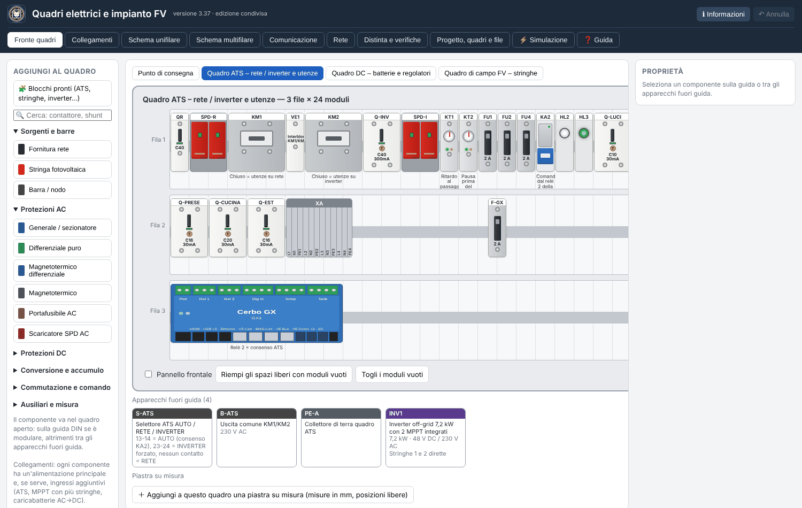
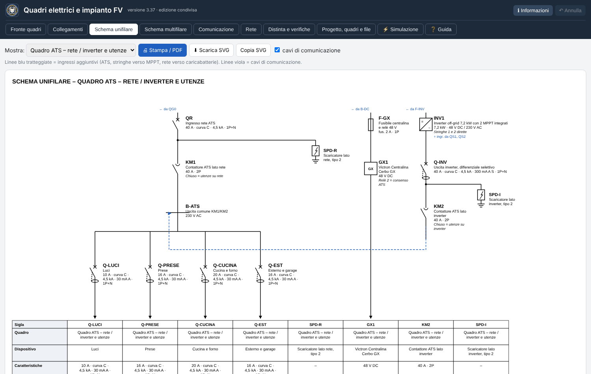
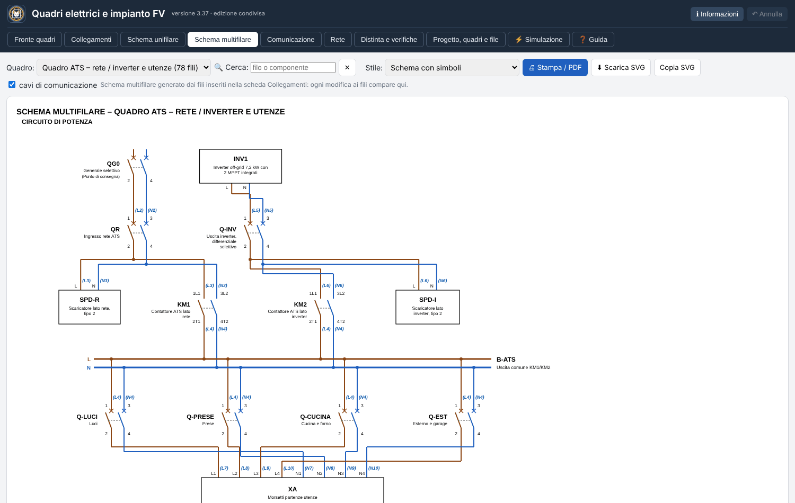
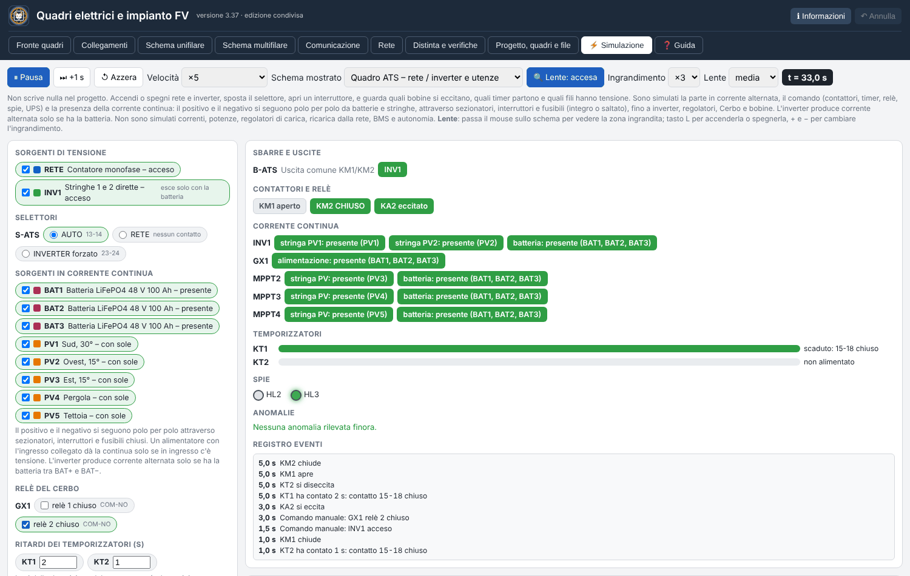
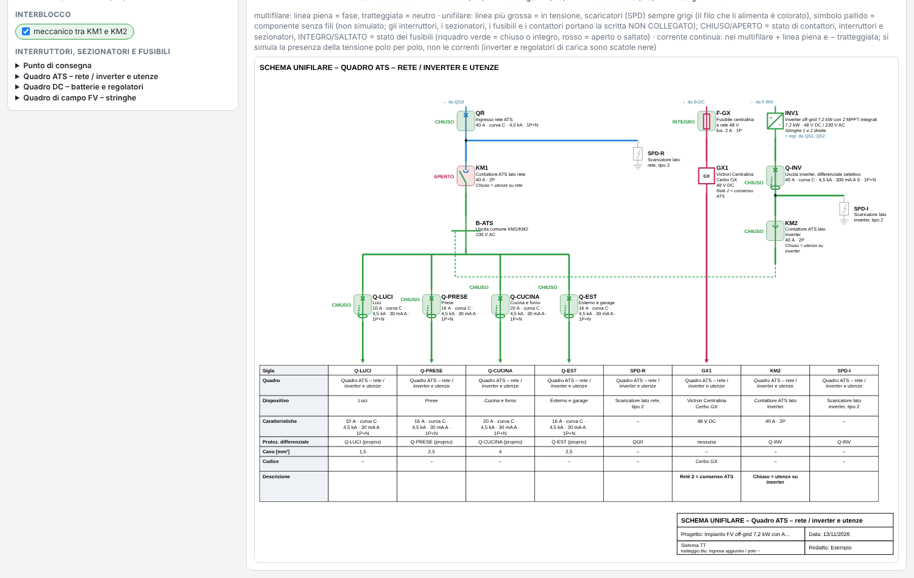
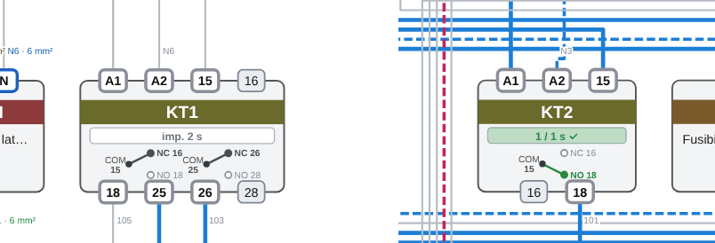
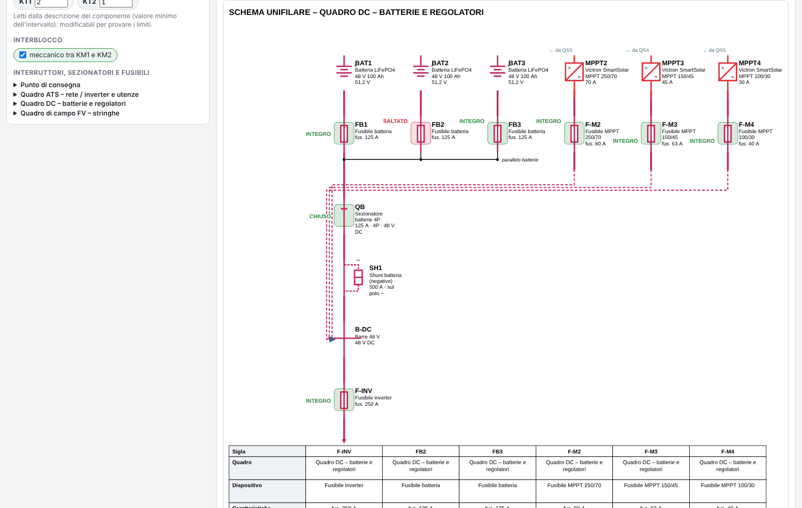
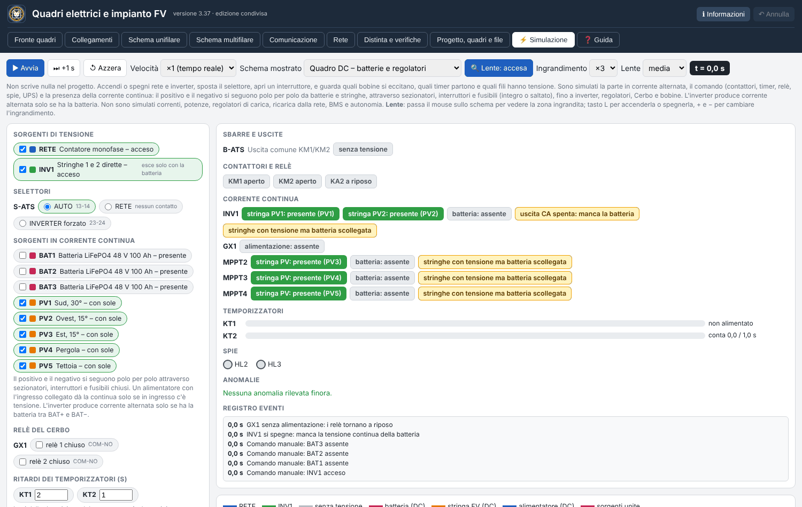
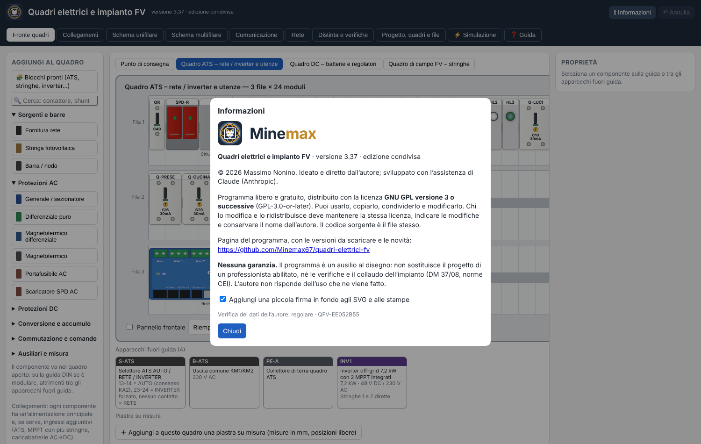

# Quadri elettrici e impianto FV

<p align="center"><picture><source media="(prefers-color-scheme: dark)" srcset="docs/img/logo_su_scuro.svg"></picture></p>

<p align="center"><a href="https://doi.org/10.5281/zenodo.24355351"></a></p>

Programma gratuito per disegnare **quadri elettrici monofase** e **impianti fotovoltaici off-grid**: si inseriscono i componenti nei quadri e i fili tra i morsetti, e il programma disegna da solo gli schemi.

È un **unico file** (`index.html`): si scarica, si apre con doppio clic in Chrome, Edge o Firefox e funziona anche senza internet. Non installa nulla, non usa librerie esterne e non invia dati a nessuno.

Versione attuale: **3.37** (19 novembre 2026), edizione condivisa.



## Cosa fa

- **Fronte quadri**: componenti sulla guida DIN o su piastra su misura, con apparecchi fuori guida; «Alimentato da» si può proporre dai fili già disegnati.
- **Collegamenti**: fili tra i morsetti con tipo, sezione e sigla, e lista di cablaggio.
- **Schema unifilare** e **schema multifilare**, disegnati dai fili inseriti, con stampa, SVG e PDF.
- **Comunicazione** e **Rete**: cavi dati tra batterie, inverter, Cerbo GX e apparecchi di rete.
- **Distinta e verifiche**: elenco dei componenti e controlli automatici sul progetto, compreso un avviso quando «Alimentato da» di uno scaricatore non coincide con i suoi fili.
- **Blocchi pronti**: gruppi di componenti già collegati tra loro (rete e interruttore generale, banco batterie, inverter con 2 MPPT, stringhe FV con o senza regolatore, quadro ATS con timer, partenze utenze) da inserire e unire al resto dell'impianto; «Annulla» toglie tutto il blocco in un colpo solo.
- **Comandi pronti**: spie colorate, selettore a manopola, pulsanti e fungo di emergenza già compilati nella palette, disegnati sul fronte quadro com'è davvero.
- **Simulazione**: si accendono e spengono rete e inverter, si spostano i selettori e si vede quali contattori si chiudono, quali relè si eccitano e quali timer partono, con il registro di ogni commutazione. Nello schema unifilare ogni contattore, interruttore, sezionatore e fusibile porta la scritta CHIUSO (verde) o APERTO (rosso) e un riquadro dello stesso colore; un componente senza fili porta la scritta grigia NON COLLEGATO. Anche la **corrente continua** è seguita polo per polo: batterie, stringhe FV e alimentatori sono sorgenti, il positivo e il negativo passano da sezionatori, interruttori e fusibili (integro o SALTATO) fino a inverter, regolatori e Cerbo GX, e l'inverter produce corrente alternata solo se ha la batteria. Nello schema unifilare un tratto di continua è colorato solo se arrivano sia il positivo sia il negativo: con un fusibile saltato il tratto a valle resta grigio. Gli scaricatori (SPD) restano grigi: non sono sorgenti né un percorso della corrente.
- **Guida** integrata nel programma (PDF in [`docs/`](docs/Guida_quadri_elettrici.pdf)).

| Schema unifilare | Schema multifilare |
| --- | --- |
|  |  |







| Corrente continua nello schema unifilare | Pannello «Corrente continua» |
| --- | --- |
|  |  |

## Come si usa

1. Vai alla pagina [Releases](https://github.com/Minemax67/quadri-elettrici-fv/releases/latest) e scarica il file `Quadri_elettrici_FV_3.37.html` (in fondo, sotto *Assets*). Il file [`index.html`](index.html) di questo repository è lo stesso programma: serve alla pagina web e, se preferisci, si scarica col pulsante **Raw** → *Salva con nome*.
2. Aprilo con doppio clic nel browser.
3. Nella scheda **Progetto, quadri e file** puoi caricare l'impianto di esempio da 7,2 kW con **Carica impianto FV di esempio**, oppure aprire un tuo file con **Apri progetto**.
4. Salva spesso il progetto con **Salva progetto (.json)**: il salvataggio automatico del browser non passa da una versione del programma all'altra, il file `.json` sì.

## Privacy

Tutto avviene nel tuo browser. Il programma non contatta nessun server e non contiene librerie o immagini caricate da internet. I progetti restano nella memoria del browser e nei file `.json` che salvi tu. L'impianto di esempio incluso nel programma è generico, senza dati personali.

## Limiti e avvertenze

- È un **ausilio al disegno**. Non sostituisce il progetto di un professionista abilitato, le verifiche e il collaudo dell'impianto (DM 37/08, norme CEI). **L'autore non risponde dell'uso che ne viene fatto.**
- Solo impianti **monofase** e in corrente continua.
- I dati dei componenti (misure, morsetti, caratteristiche) sono ricavati dalle schede tecniche pubbliche dei produttori. Controllali sempre sul documento originale prima di acquistare o cablare.
- La **Simulazione** segue la parte in corrente alternata, il comando (contattori, timer, relè, selettori, gruppo di continuità, relè del Cerbo GX) e la presenza di tensione continua polo per polo. Non simula correnti e potenze, regolatori di carica (MPPT), ricarica dalla rete, BMS e autonomia; l'inverter è una scatola nera; i fusibili non saltano da soli per sovracorrente (si fanno saltare a mano).
- Nomi di produttori e modelli sono usati solo per identificare i componenti e appartengono ai rispettivi proprietari. Il progetto non è affiliato a nessuno di essi e questo repository non contiene loro immagini né testi.

## Licenza

Programma libero, distribuito con la licenza **GNU GPL versione 3 o successive** (`GPL-3.0-or-later`), testo completo in [`LICENSE`](LICENSE). Puoi usarlo, copiarlo, condividerlo e modificarlo. Chi lo modifica e lo ridistribuisce deve mantenere la stessa licenza, indicare le modifiche e conservare il nome dell'autore. Non c'è nessuna garanzia.

© 2026 Massimo Nonino. Ideato e diretto dall'autore; **sviluppato con l'assistenza di Claude (Anthropic)**.

Il pulsante **ℹ Informazioni** del programma mostra versione, autore, licenza e avvisi, e permette di togliere la piccola firma che compare in fondo agli SVG esportati e alle stampe.



## Logo

Il logo «Minemax» è quello dell'autore: un lupo davanti a una ruota, con un circuito integrato e piste di rame. Compare nell'intestazione del programma, come icona della scheda del browser e nella finestra Informazioni. Il disegno (SVG) è in [`docs/img/logo.svg`](docs/img/logo.svg), con la versione per sfondi scuri in [`docs/img/logo_su_scuro.svg`](docs/img/logo_su_scuro.svg).

## Come verificare che il file sia l'originale

L'impronta SHA-256 di `index.html` è nel file [`SHA256SUMS.txt`](SHA256SUMS.txt) e nella pagina della versione. Da terminale:

```
sha256sum -c SHA256SUMS.txt
```

Il programma controlla anche da solo i dati dell'autore: se in una copia modificata vengono alterati, compare una striscia rossa in alto. È un segnale di manomissione, non una protezione: la licenza GPL consente le modifiche, purché dichiarate.

## Modificare il programma

Il programma è tutto in `index.html`. In [`docs/NOTE_TECNICHE.md`](docs/NOTE_TECNICHE.md) trovi com'è fatto, come provarlo e un testo pronto da incollare se lavori con un assistente AI. Il registro delle novità è in [`CHANGELOG.md`](CHANGELOG.md).

## Segnalazioni

Se trovi un errore (un morsetto sbagliato, uno schema che non torna), apri una segnalazione in **Issues** con il file `.json` del progetto, se non contiene dati personali, e una schermata. Per i dati dei componenti indica il documento del produttore su cui si basa la correzione.

## Citazione

Ogni versione pubblicata come release è archiviata su Zenodo. Il DOI [10.5281/zenodo.24355351](https://doi.org/10.5281/zenodo.24355351) rappresenta tutte le versioni e porta sempre all'ultima; sulla pagina di Zenodo c'è anche il DOI di ciascuna versione. I dati per citare il programma sono in [`CITATION.cff`](CITATION.cff).
